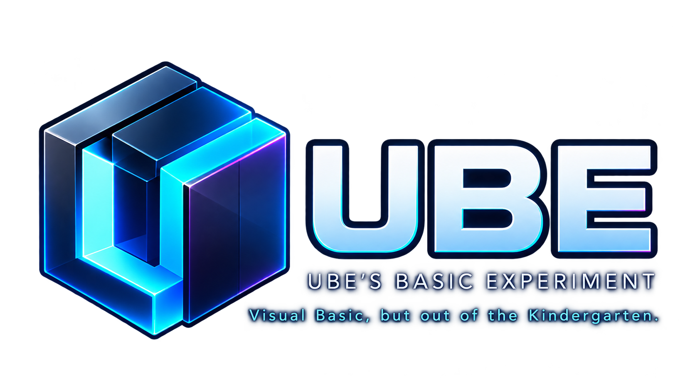

# UBE — Work in Progress

**UBE** is a new native, 64-bit programming language and compiler inspired by classic Visual Basic 6.

  

<em>Dreamed up by an idiot. Brought to life with AI.</em>

## Vision
UBE keeps the readable syntax and direct workflow that made classic Basic easy
to learn and productive to use. It adds clearly defined modern behavior,
strict types, native threads, managed memory, portable libraries, and a fully
64-bit toolchain.

UBE programs should compile to small, fast native executables. The compiler and
standard library are intended to remain understandable, dependency-minimal,
and portable across supported operating systems.

The long-term goal is a complete native development system:

- the UBE language and optimizing compiler;
- a portable standard library written in UBE;
- source-level debugging;
- a responsive native IDE with the simplicity of the VB6 environment; and
- tools for building, testing, packaging, and maintaining UBE programs.

## Project status
*UBE is in early development and is not ready for production use.*

**The compiler now builds itself and compiles in parallel.** The VB6 bootstrap builds the UBE-written compiler, which has completed two successive self-builds as a native 64-bit Windows executable. The latest self-builds took approximately 15–16 seconds each on the development machine.

Both self-built compilers generate byte-identical LLVM. Their native executables match after normalizing only the PE timestamp. The bootstrap and both self-built compilers pass the same tests for supported language features, errors and recovery, with optimization both off and on. Failed builds preserve earlier output files.

The compiler uses two native workers for independent code emission, with a single-worker comparison mode. Tests cover overlapping work, simultaneous independent requests, deterministic output, failure isolation, cancellation and recovery. On a fixed 51-module workload, source-to-LLVM compilation averaged 3.549 seconds with two workers versus 3.927 seconds with one: 9.63% faster on the tested machine. This measurement excludes the native backend.

The current language subset includes multiple modules, records, arrays, checked arithmetic, error handling, explicit file operations and native `CallNew` workers. The full language, source-level debugging and IDE remain under development.

See the [self-hosting results](compiler/Progress.md) for commands and test evidence, and the [development plan](project-docs/Development-Plan.md) for upcoming work.

## Frequently Asked Questions
- Is UBE an attempt to create Visual Basic 7? 
  **No.** 
  TwinBASIC is carrying the Visual Basic legacy forward, with a strong focus on compatibility with existing VB6 code. 
  UBE is a different experiment. 
  The idea behind UBE is simple: <i>What if we took a language designed for beginners and kept extending it until it could do virtually anything?</i> 
  UBE takes inspiration from the simplicity, readability and accessibility of classic Visual Basic, but does not consider VB6 Runtime-compatibility a design requirement. 
- So, what exactly is UBE? 
  UBE is an attempt to build a powerful, modern, general-purpose programming language around the original philosophy of BASIC: Programming should be understandable, approachable and enjoyable. 
  The goal is not to make a simpler language. It is to make advanced capabilities accessible through a simple language. 
  In other words, UBE aims to preserve VB's friendliness without preserving its historical limitations. 
- What makes UBE different from Visual Basic 6? 
  Several things, both internally and in the language itself.:
  - **A minimal compiler core.** 
    UBE's compiler is designed to understand only the essential building blocks of the language. Much of the higher-level functionality is implemented in a separate standard library. 
  - **Extensible native types.** 
    UBE aims to allow developers to define their own native data types, including their memory representation and how values are initialized, accessed and destroyed. 
  - **Modern compilation.** 
    UBE uses LLVM as its backend, allowing the compiler to target different architectures without requiring a separate code generator for each platform. 
  - **Strict declarations, friendly conversions.** 
    Variables must be explicitly declared and types are checked, but the runtime still supports convenient automatic conversions where they make sense. 
  - **A different approach to runtime errors.** 
    A failing call reports FAIL and records error information. By default, the caller skips the failed statement; an enabled handler can redirect execution. Err.Raise exits the raising procedure immediately, so it must perform its own resource cleanup beforehand. 
- Will UBE compile existing VB6 projects? 
  **Yes. All valid VB6 code is intended to compile in UBE.** 
  UBE preserves VB6 syntax while deliberately reconsidering some of its underlying semantics, including error handling, type conversions, and other runtime behaviors. 
  This means existing VB6 code will compile without modification, but certain VB6 quirks may behave differently. 
  *If exact VB6 behavior is a requirement, TwinBASIC is likely the better choice for you.*
- Is UBE designed for beginners or experienced programmers? 
  **Both.** 
  A beginner should be able to write a simple program without first understanding memory management, compiler architecture or complex type systems. 
  An experienced developer should be able to access those capabilities when needed. 
  Complexity is available, not mandatory. 
- Is UBE ready for production use? 
  **Not yet.** 
  UBE is under active development. 
- Is UBE intended to replace Visual Basic, TwinBASIC or other programming languages? 
  **No.** 
  UBE is being developed just because I want to. 

## How UBE is being built
UBE is created by Ube, who defines the vision, product direction, and final
decisions. AI coding agents help turn that direction into specifications,
compiler code, tests, documentation, and project tooling.

The agents work inside repository-defined boundaries. Their work is reviewed
against the language specification, automated tests, and Ube's requirements.
AI is used as an engineering tool; project
ownership and design authority remain with Ube.

## First public-release goals

- Familiar Basic syntax with clearly defined modern behavior.
- Small, fast 64-bit native programs.
- Reliable compilation with support for multithreaded builds.
- A reusable, portable standard library.
- Clear diagnostics, debugging support, and complete offline documentation.

## Development builds

See the [build documentation](bootstrap/README.md) for prerequisites and
instructions for compiling admitted programs and running the bootstrap tests.
The [self-hosting guide](bootstrap/SELF-HOSTING.md) describes the compiler build
and acceptance gates. The compiler is not yet available as a packaged release.

## Repository guide

- [docs/](docs/README.md) — public UBE language manual
- [lang-doc/](lang-doc/README.md) — normative language specification and grammar
- [project-docs/](project-docs/README.md) — architecture and development roadmap
- [compiler/](compiler/README.md) — compiler plan, source profile and acceptance gates
- [std-lib/](std-lib/README.md) — fresh UBECore standard-library project
- [bootstrap/](bootstrap/README.md) — VB6 bootstrap compiler and native tests
- [runtime/](runtime/README.md) — native worker runtime, regression tests and profiling helpers
- [Release-Requirements.md](Release-Requirements.md) — owner-defined release requirements
- [Workplan.md](Workplan.md) — current repository-wide work checkpoint

## License and credits

UBE is open-source software. See [LICENSE](LICENSE) for license terms and
[CONTRIBUTORS.md](CONTRIBUTORS.md) for project credits.

## Support development

UBE is free and open-source. Donations are appreciated, and will help progress
faster. You can support the project through
[PayPal](https://www.paypal.me/Ubehage).

## Community

Join the [UBE Discord](https://discord.gg/XZjSw6wxhR) to suggest ideas, report
bugs, and follow development.
