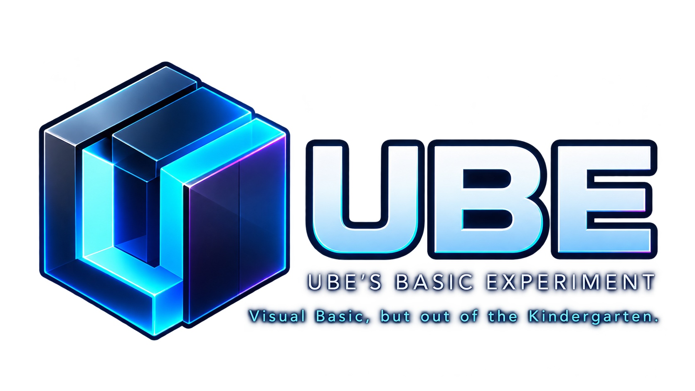

# UBE — Work in Progress

**UBE** is a new native, 64-bit programming language and compiler inspired by classic Visual Basic 6.

<p align="center">
  
</p>

<p align="center"><sub><em>Dreamed up by an idiot. Brought to life by AI.</em></sub></p>

## Vision
UBE keeps the readable syntax and direct workflow that made classic Basic easy
to learn and productive to use. It adds clearly defined modern behavior,
strict types, native threads, managed memory, portable libraries, and a fully
64-bit toolchain.

UBE programs should compile to small, fast native executables. The compiler and
standard library are intended to remain understandable, dependency-minimal,
and portable across supported operating systems.

The long-term goal is a complete native development system:

- the UBE language and optimizing compiler;
- a portable standard library written in UBE;
- source-level debugging;
- a responsive native IDE with the simplicity of the VB6 environment; and
- tools for building, testing, packaging, and maintaining UBE programs.

UBE does not use Tauri, Electron, or webview shells for its native tools.


## Frequently Asked Questions
- Is UBE an attempt to create Visual Basic 7?<br>
  **No.**<br>
  TwinBASIC is carrying the Visual Basic legacy forward, with a strong focus on compatibility with existing VB6 code.<br>
  UBE is a different experiment.<br>
  The idea behind UBE is simple: <i>What if we took a language designed for beginners and kept extending it until it could do virtually anything?</i><br>
  UBE takes inspiration from the simplicity, readability and accessibility of classic Visual Basic, but does not consider VB6 Runtime-compatibility a design requirement.<br>
- So, what exactly is UBE?<br>
  UBE is an attempt to build a powerful, modern, general-purpose programming language around the original philosophy of BASIC: Programming should be understandable, approachable and enjoyable.<br>
  The goal is not to make a simpler language. It is to make advanced capabilities accessible through a simple language.<br>
  In other words, UBE aims to preserve VB's friendliness without preserving its historical limitations.<br>
- What makes UBE different from Visual Basic 6?<br>
  Several things, both internally and in the language itself.:
  - **A minimal compiler core.**<br>
    UBE's compiler is designed to understand only the essential building blocks of the language. Much of the higher-level functionality is implemented in a separate standard library.<br>
  - **Extensible native types.**<br>
    UBE aims to allow developers to define their own native data types, including their memory representation and how values are initialized, accessed and destroyed.<br>
  - **Modern compilation.**<br>
    UBE uses LLVM as its backend, allowing the compiler to target different architectures without requiring a separate code generator for each platform.<br>
  - **Strict declarations, friendly conversions.**<br>
    Variables must be explicitly declared and types are checked, but the runtime still supports convenient automatic conversions where they make sense.<br>
  - **A different approach to runtime errors.**<br>
    Rather than interrupting execution for ordinary recoverable failures, UBE is designed to return an invalid or default value and record error information for the programmer to inspect.<br>
- Will UBE compile existing VB6 projects?<br>
  **Yes. All valid VB6 code is intended to compile in UBE.**<br>
  UBE preserves VB6 syntax while deliberately reconsidering some of its underlying semantics, including error handling, type conversions, and other runtime behaviors.<br>
  This means existing VB6 code will compile without modification, but certain VB6 quirks may behave differently.<br>
  *If exact VB6 behavior is a requirement, TwinBASIC is likely the better choice for you.*
- Is UBE designed for beginners or experienced programmers?<br>
  **Both.**<br>
  A beginner should be able to write a simple program without first understanding memory management, compiler architecture or complex type systems.<br>
  An experienced developer should be able to access those capabilities when needed.<br>
  Complexity is available, not mandatory.<br>
- Is UBE ready for production use?<br>
  **Not yet.**<br>
  UBE is under active development.<br>
- Is UBE intended to replace Visual Basic, TwinBASIC or other programming languages?<br>
  **No.**<br>
  UBE is being developed just because I want to.<br>
  I am trying to realize an old dream.


## How UBE is being built
UBE is created by Ube, who defines the vision, product direction, and final
decisions. AI coding agents help turn that direction into specifications,
compiler code, tests, documentation, and project tooling.

The agents work inside repository-defined boundaries. Their work is reviewed
against the language specification, automated tests, preserved compiler
generations, and Ube's requirements. AI is used as an engineering tool; project
ownership and design authority remain with Ube.

## Project status

> **Current milestone:** Compiler v3 Release Preview 8 is complete. Beta 1
> multithreading Phases 0 and 1 are complete: sequential performance is
> measured, and the preserved Compiler v2 now reproducibly builds a dedicated
> sequential seed that builds the production compiler without a pre-existing
> production binary. Work now moves to the bounded one-job executor.

<ul>
  <li><strong>UBE 1.0</strong><br><sub>The language definition, grammar, compiler boundaries, and staged development plan are frozen.</sub></li>
  <li><strong>Compiler v2</strong><br><sub>The stable transitional compiler is self-hosting, supports multiple modules and cross-module references, and reproducibly builds the Compiler v3 sequential seed.</sub></li>
  <li><strong>Compiler v3 RP8</strong><br><sub>The self-hosting compiler adds bounded project groups, hashed resources and compiled-library bundles, optimization/debug controls, complete debugger metadata modes, explicit compatibility diagnostics, and Linux x86-64 ELF emission.</sub></li>
  <li><strong>UBECore</strong><br><sub>The separate 16-module source-library slice exposes and tests its minimum RP8 public API while keeping portable modules separate from Windows adapters. Both compiler stages reproduce it exactly.</sub></li>
  <li><strong>Verification</strong><br><sub>The clean RP8 gate reproduces byte-identical self-hosted LLVM, matching normalized COFF objects, identical UBECore output, 50 recorded cross-stage corpus cases, and a Clang-accepted Linux ELF object.</sub></li>
  <li><strong>Beta 1 performance</strong><br><sub>An opt-in sequential profiler records phase time, CPU, peak memory, structural counts, IR size, and output size. Three-run self, UBECore, many-source, and many-procedure baselines now guide deterministic parallelization.</sub></li>
  <li><strong>Bootstrap trust</strong><br><sub>A separately identified v2-buildable seed produces the production compiler, whose three stages emit identical LLVM. The build records seed, executor, job-count, timing, and normalized-object identities.</sub></li>
  <li><strong>Documentation</strong><br><sub>The offline manual and expandable A-Z language reference are available, with planned behavior distinguished from verified behavior.</sub></li>
</ul>

UBE remains pre-release software and is not yet ready for production use.

## First public-release goals

- A stable UBE language definition and grammar. ✔️
- A self-hosting v3 compiler built with the preserved v2 compiler. ✔️
- Lightweight, optimized 64-bit native executables. ✔️
- A minimal compiler with runtime and standard-library functionality kept in a
  separate UBE source library. 🚧
- Multiple source modules with clear visibility and reference rules. ✔️
- Defined conversions, errors, lifetimes, garbage collection, and threading. ✔️
- Portable behavior with platform-specific features clearly identified. 🚧
- Complete offline language and library documentation. 🚧
- Useful diagnostics and the foundations required for source-level debugging. ✔️

## Building the current compiler

The current bootstrap build targets x86-64 Windows and requires PowerShell,
GCC/MinGW-w64, and LLVM/Clang. From the repository root, run:

```powershell
./bootstrap/build.ps1
```

The command builds and tests stage zero, preserved compiler generations, the
v2 self-hosting chain, Compiler v3 RP8 and its complete inherited and RP8
corpora, the current 16-module `UBECore` source slice, runtime probes,
resource/library compatibility checks, debugger and optimization modes,
Windows native execution, Linux ELF emission, and conformance fixtures. See
[bootstrap/README.md](bootstrap/README.md) for prerequisites and details.

## Repository guide

- [docs/](docs/README.md) — public UBE language manual
- [lang-doc/](lang-doc/README.md) — normative language specification and grammar
- [project-docs/](project-docs/README.md) — architecture and development roadmap
- [compiler/](compiler/README.md) — preserved UBE compiler generations
- [source-library/](source-library/README.md) — separately built UBE source library
- [bootstrap/](bootstrap/README.md) — temporary stage-zero compiler and tests
- [Release-Requirements.md](Release-Requirements.md) — owner-defined release requirements
- [Workplan.md](Workplan.md) — current repository-wide work checkpoint

## License and credits

UBE is open-source software. See [LICENSE](LICENSE) for license terms and
[CONTRIBUTORS.md](CONTRIBUTORS.md) for project credits.

## Support development

UBE is free and open-source. Donations are appreciated, and will help progress
faster. You can support the project through
[PayPal](https://www.paypal.me/Ubehage).

## Community

Join the [UBE Discord](https://discord.gg/XZjSw6wxhR) to suggest ideas, report
bugs, and follow development.
